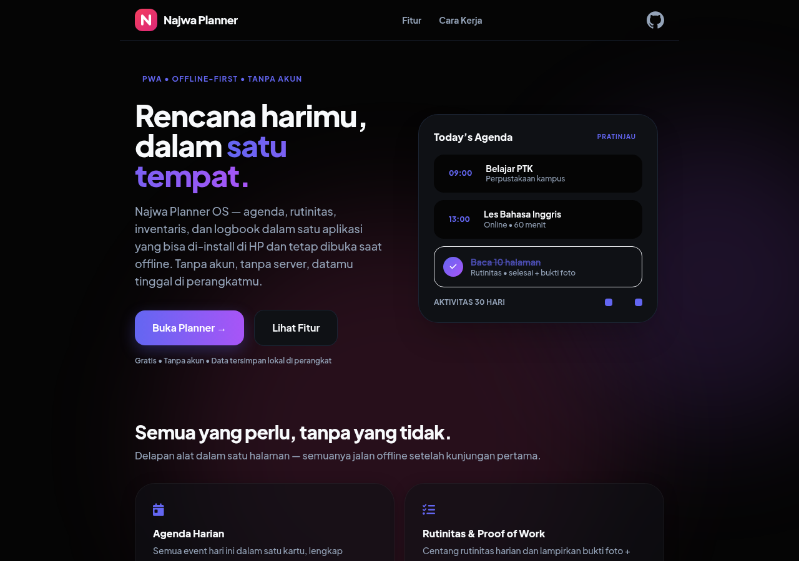
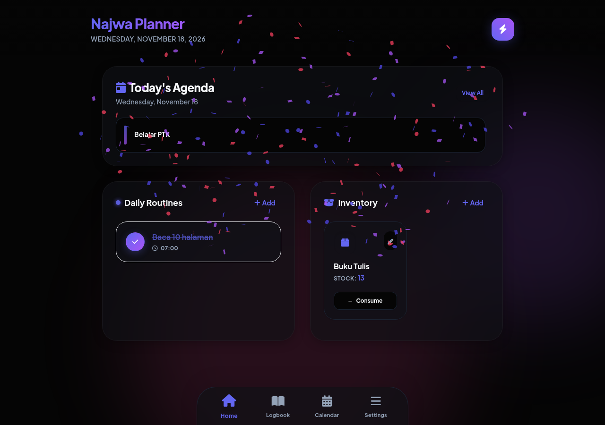
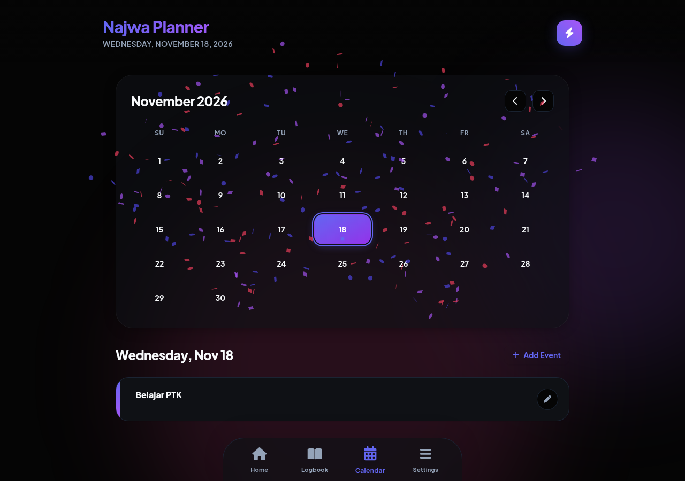

# Najwa Planner

Najwa Planner OS — agenda harian, rutinitas, inventaris, dan logbook dalam satu PWA offline-first. Tanpa akun, tanpa server: semua data tersimpan lokal di perangkat.

🌐 **Live:** https://najwa-planner.pages.dev

[](https://github.com/dezzorigin/najwa-planner/actions/workflows/ci.yml)

## Tangkapan layar

| Landing | Aplikasi | Kalender |
|---|---|---|
|  |  |  |

## Demo video

[](docs/demo/demo.mp4)

> Klik gambar di atas untuk memutar video demo (tanpa suara — direkam headless, tanpa audio). GitHub tidak menampilkan tag `<video>` di README, jadi demo disajikan sebagai tautan.

## Fitur

- **Landing page** — halaman depan ala SaaS (hero, fitur, cara kerja) sebelum masuk aplikasi; tampil pertama kali bagi pengguna baru, kunjungan berikut langsung masuk aplikasi.
- **Agenda harian** — semua event hari ini dalam satu kartu, lengkap dengan jam dan lokasi.
- **Rutinitas harian** — tambah rutinitas berulang (mis. baca 10 halaman tiap 07:00), urut otomatis berdasarkan jam.
- **Proof of Work** — selesaikan rutinitas dengan bukti: catatan + foto (otomatis dikompres di bawah 150 KB). Sekali sehari per rutinitas, dirayakan confetti.
- **Inventory** — stok barang tercatat; kurangi satu ketukan lewat tombol Consume.
- **Logbook & heatmap** — jejak rutinitas yang selesai per tanggal, plus peta aktivitas 30 hari terakhir (klik untuk membuka).
- **Kalender** — sebulan penuh; ketuk tanggal untuk melihat dan menambah agenda di tanggal itu.
- **Sinkronisasi antar perangkat (P2P)** — kirim seluruh data ke perangkat lain via WebRTC (PeerJS). Data berpindah langsung antar perangkat; pensinyalan koneksi memakai broker publik PeerJS.
- **Laporan PDF** — ekspor riwayat/logbook, agenda kalender, atau status inventaris jadi PDF (html2pdf.js).
- **Vault PIN** — catatan Proof of Work dan event sensitif bisa dienkripsi AES-GCM dengan PIN 4 digit; tanpa PIN yang benar isinya tidak bisa dibaca.
- **Tema** — Dark, Light, Pink.
- **PWA** — bisa di-install di ponsel/desktop dan dibuka offline setelah satu kali kunjungan online (service worker men-cache halaman + library CDN).

## Cara menjalankan

Tidak ada proses build dan tidak ada dependensi yang perlu di-install — ini situs statis murni (satu file `index.html` + `manifest.json` + `sw.js` + ikon).

```bash
# Cara paling gampang: layani folder ini lewat HTTP
python3 -m http.server 8080
# lalu buka http://localhost:8080
```

Atau buka `index.html` langsung di browser. Catatan: service worker (syarat PWA + mode offline) hanya aktif lewat `http(s)://`, tidak lewat `file://` — jadi untuk menguji install/offline, pakai server HTTP seperti di atas.

## Data & privasi

- **Tidak ada akun, tidak ada server, tidak ada data yang keluar.** Rutinitas, event, log, dan inventaris tersimpan di IndexedDB (`NajwaPlannerDB_v2`); tema dan status "sudah pernah masuk" di `localStorage` (`najwaTheme`, `najwaEntered`).
- Reset total tersedia di Pengaturan → Reports & Data → Wipe All Data (menghapus `localStorage` + IndexedDB).
- Satu-satunya koneksi keluar adalah sinkronisasi P2P yang diaktifkan manual oleh pengguna (PeerJS) dan library CDN saat pertama kali dibuka.

## Batasan yang diketahui

- **Sinkronisasi P2P butuh internet** dan broker publik PeerJS (0.peerjs.com) untuk pensinyalan awal; kalau broker itu tidak terjangkau, Device ID tidak muncul dan sync tidak bisa dimulai. Data sync-nya sendiri berpindah langsung antar perangkat (WebRTC), bukan lewat server.
- **Foto Proof of Work disimpan sebagai base64 di IndexedDB** — foto besar yang sudah dikompres tetap menambah ukuran database perangkat.
- **Ekspor PDF butuh library html2pdf.js dari CDN** — pertama kali dibuka harus online; setelah service worker men-cache-nya, ekspor jalan offline.
- **Tailwind CSS di-vendor lokal** (`tailwind.js`, v3.4.17) — bukan dari CDN — karena `fetch()` ke `cdn.tailwindcss.com` gagal di sebagian jaringan/proxy, sehingga service worker tidak bisa men-cache-nya dan mode offline rusak. Library lain (Font Awesome, html2pdf.js, PeerJS, confetti, font) masih dari CDN dan ikut di-cache service worker.
- **PIN Vault bukan pengganti keamanan perangkat**: PIN 4 digit melindungi dari orang yang membuka aplikasi, bukan dari akses langsung ke file database bila perangkat sudah tidak terkunci.

## Perbaikan v1.1.0

Tiga bug nyata yang ditemukan saat play-test rebuild ini, semuanya diperbaiki:

1. **Tombol "View All" melempar TypeError** — `switchView()` memakai `event.currentTarget` dan mengasumsikan pemanggil selalu punya ikon `<i>`; tombol View All tidak punya ikon, jadi tiap diklik muncul uncaught error dan `renderCalendar()`/`renderAgenda()` di bawahnya tidak pernah jalan. Sekarang status aktif diambil dari tombol nav berdasarkan `viewId`, dengan guard null di semua akses ikon.
2. **Agenda hari ini tidak segar setelah tambah/hapus event** — `saveEvent()`/`deleteEvent()` hanya me-render ulang tampilan kalender, bukan kartu "Today's Agenda" di Home, jadi event baru tak terlihat sampai reload. Sekarang keduanya memanggil `loadHUD()`.
3. **Service worker tidak pernah didaftarkan** — `sw.js` ada dan `manifest.json` mengklaim offline-first, tapi tidak ada satu baris pun kode yang memanggil `navigator.serviceWorker.register()`, jadi mode offline sebenarnya tidak jalan. Sekarang didaftarkan saat load; daftar cache juga dibersihkan (URL flaticon yang tidak pernah dipakai aplikasi dihapus — `cache.addAll()` gagal total bila satu saja URL-nya gagal di-fetch) dan ikon PNG 192/512 ditambahkan agar PWA bisa di-install.

Selain itu: landing page ala SaaS, viewport kini mengizinkan zoom (sebelumnya `user-scalable=no`), seluruh HTML dibersihkan sampai lolos `html-validate` (sebelumnya 83 error: tombol tanpa `type`, tombol ikon tanpa teks aksesibel, satu `</div>` nyasar, `&` mentah, `img` tanpa `alt`), dan CI kini menegakkan skor kategori PWA Lighthouse.

## Struktur proyek

```
index.html          # aplikasi + landing (satu file, tanpa build step)
tailwind.js         # Tailwind CSS v3.4.17 browser build, di-vendor lokal (MIT)
manifest.json       # manifest PWA (ikon PNG 192/512 + SVG)
sw.js               # service worker (cache offline)
logo.svg            # logo (huruf N)
icon-192.png        # ikon PWA 192x192
icon-512.png        # ikon PWA 512x512 (any + maskable)
og-image.png        # gambar preview Open Graph/Twitter (screenshot asli landing, 1200x630)
README.md
PRD.md
CHANGELOG.md
CODE_OF_CONDUCT.md
LICENSE             # MIT
docs/
  architecture.md
  diagrams/app-flow.svg
  screenshots/      # tangkapan layar tampilan asli
  demo/demo.mp4     # video demo (tanpa suara)
.github/workflows/ci.yml
lighthouserc.json
```

## Lisensi

MIT — lihat [LICENSE](./LICENSE).
